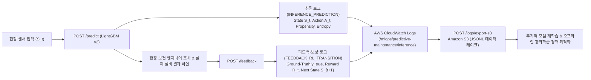

# 9주차 — 팀 프로젝트 한 문장 정의 및 CloudWatch 재학습/강화학습 로깅·S3 내보내기 보고서

---

## 1. 팀 프로젝트 한 문장 설명 (Service Definition & Persona)

> **"CNC 밀링 설비의 6대 실시간 공정·센서 데이터(제품 품질 등급, 대기 온도, 공정 온도, 주축 회전수, 모터 토크, 공구 누적 마모 시간)와 물리 법칙 기반 파생 피처를 입력받아 설비의 고장 발생 여부 및 고장 확률을 실시간으로 예측하는 서비스로, 스마트팩토리 정밀 가공 라인의 현장 설비 보전 엔지니어(Maintenance Engineer)와 생산 라인 교대조 반장(Shift Supervisor)이 제조 현장 설비 관제 웹 대시보드 및 라인 순찰용 산업용 태블릿에서 돌발 설비 셧다운(Unplanned Downtime)과 공구 파손에 따른 불량품 발생을 사전에 예방하고 최적의 공구 교체·정비 시점을 의사결정하기 위해 사용한다."**

### 1.1 핵심 구성 요소 분해표

| 구분 | 정의 내용 |
| :--- | :--- |
| **어떤 데이터로 (Input Data)** | CNC 밀링 머신에서 수집되는 **6대 실시간 공정·센서 데이터**(`Type` 제품 등급 L/M/H, 대기 온도 `Air temperature [K]`, 공정 온도 `Process temperature [K]`, 주축 회전수 `Rotational speed [rpm]`, 모터 토크 `Torque [Nm]`, 절삭 공구 마모 시간 `Tool wear [min]`) 및 이를 도메인 물리 공식으로 변환한 **17종의 물리·임계 마진 파생 피처(총 23개 피처)** |
| **어떤 것을 예측하는 서비스인가 (Prediction Target)** | 현재 가공 조건에서의 **실시간 설비 고장 발생 여부(`machine_failure`: 0 또는 1)**와 **고장 확률(`failure_probability`: 0.0~1.0)**, 그리고 4대 물리적 고장 메커니즘(방열 불량 `HDF`, 전력 이상 `PWF`, 과부하 `OSF`, 공구 마모 `TWF`)의 임계 위험도 및 권고 정비 조치 |
| **누가 쓰는가 (실제 사용자 페르소나)** | 1. **스마트팩토리 CNC 정밀 가공 라인의 현장 설비 보전 엔지니어 (Maintenance Engineer)**<br>2. **생산 라인 교대조 반장 및 공정 품질 관리자 (Shift Supervisor & Process Quality Manager)** |
| **어디에 쓰는가 (Where / Environment)** | 제조 공장 내 **중앙 설비 관제실 웹 대시보드(MES/SCADA 연동 모니터링 터미널)** 및 현장 작업자가 설비 점검 시 휴대하는 **공정 순찰용 산업용 태블릿·현장 키오스크** |
| **왜 쓰는가 (Why / Business Value)** | • **돌발 셧다운(Unplanned Downtime) 방지**: 주축 모터 소손이나 공구 파손으로 라인 전체가 멈추는 대형 사고를 사전에 차단<br>• **가공 불량(Scrap) 예방**: 마모 한계(200분 이상) 및 과부하(OSF) 상태에서 가공을 강행해 고가의 금속 가공품이 폐기되는 손실 방지<br>• **과잉 정비(False Positive) 비용 절감**: 수명이 남은 공구를 너무 일찍 교체하거나 불필요하게 라인을 세우는 오탐 비용을 최소화하고 최적의 예방정비(PdM) 시점을 결정 |

### 1.2 실제 사용자 페르소나 상세 정의

1. **페르소나 A — 현장 설비 보전 엔지니어 (김철수 기장, 경력 8년차 CNC 보전팀)**
   - **업무 환경**: 20여 대의 CNC 밀링 머신이 24시간 가동되는 자동차 부품 정밀 가공 공장에서 설비 점검, 냉각 계통 정비, 인버터 전력 점검 및 스핀들 수리를 담당.
   - **페인 포인트(Pain Point)**: 원시 센서 수치(온도 K, 토크 Nm, 회전수 RPM)만 눈으로 봐서는 복합 물리 조건(예: $\Delta T < 8.6\text{ K}$ 이면서 $\text{RPM} < 1,380$인 방열 불량 `HDF`나 $\text{Tool wear} \times \text{Torque}$가 등급별 한계를 넘는 과부하 `OSF`)을 즉각 계산하기 어려움.
   - **서비스 활용 방식**: 관제 웹 대시보드와 태블릿에서 고장 확률 게이지와 물리 마진 지표를 실시간으로 확인하고, 위험 경보 시 즉시 냉각수 노즐을 청소하거나 인버터 부하를 조정한 뒤 조치 결과(`POST /feedback`)를 기록함.
2. **페르소나 B — 생산 라인 교대조 반장 (이영희 반장, 경력 12년차 생산관리팀)**
   - **업무 환경**: 주·야간 교대 시점마다 L(보급형)·M(표준형)·H(고정밀) 제품군 작업 지시서를 배정하고 일일 생산량(납기)과 불량률을 총괄 관리.
   - **페인 포인트(Pain Point)**: 고정밀(H) 제품 가공 투입 직전에 절삭 공구 교체 여부를 결정해야 하나, 무조건 일찍 교체하면 공구 비용과 교체 정지 시간이 늘어나고 늦게 교체하면 가공 중 파손으로 대량 불량이 발생함.
   - **서비스 활용 방식**: 다음 배치 작업 투입 전 설비의 누적 마모 시간과 목표 토크·회전수를 입력해 고장 확률을 시뮬레이션하고, 모델의 권고 행동(`CONTINUE_NORMAL_OPERATION` vs `PREVENTIVE_INSPECTION` vs `IMMEDIATE_SHUTDOWN_MAINTENANCE`)을 근거로 공구 교체 후 가동할지 연속 가동할지 의사결정함.

---

## 2. 모델 동작 확인 결과 (Step 2)

프로덕션 서빙 모델(`models/lightgbm_model.txt`, 23개 도메인·마진 피처 기반 LightGBM v2)의 로드 상태, 피처 정합성, 그리고 4대 대표 산업 시나리오에 대한 추론 동작을 검증했습니다.

### 2.1 모델 아티팩트 및 홀드아웃 테스트 성능 요약
- **모델 파일**: [`models/lightgbm_model.txt`](../models/lightgbm_model.txt) (LightGBM Booster, 입력 피처 23개, 결정 임계값 $\tau = 0.50$)
- **홀드아웃 테스트셋(2,000건) 검증 성능**:
  - **Accuracy**: `99.45%` (1,989 / 2,000)
  - **Precision**: `100.00%` (**오탐 FP 0건**)
  - **Recall**: `83.82%` (57 / 68)
  - **F1-Score**: `0.9120` | **PR-AUC**: `0.9087`

### 2.2 4대 공학 시나리오별 모델 추론 검증 결과

| 시나리오 | 입력 센서 파라미터 (`type`, `Air K`, `Proc K`, `RPM`, `Torque Nm`, `Wear min`) | 주요 파생 물리 피처 연산값 | 예측 고장 확률 (`failure_probability`) | 예측 분류 (`machine_failure`) | 권고 정비 행동 (`recommended_action`) |
| :--- | :--- | :--- | :---: | :---: | :--- |
| **1. 정상 가동 설비 (Normal)** | `L`, `300.0`, `310.0`, `1500`, `40.0`, `100` | $\Delta T = 10.0\text{ K}$, $P = 6,283.2\text{ W}$, $\text{Strain} = 4,000$ | **0.008099 (0.81%)** | **`0` (정상)** | `CONTINUE_NORMAL_OPERATION` |
| **2. 열 방출 실패 (HDF)** | `L`, `302.5`, `310.5`, `1320`, `52.0`, `110` | $\Delta T = 8.0\text{ K} (<8.6)$, $\text{RPM} = 1,320 (<1,380)$, `hdf_risk=1` | **0.985413 (98.54%)** | **`1` (고장)** | `IMMEDIATE_SHUTDOWN_MAINTENANCE` |
| **3. 과부하 및 마모 (OSF/TWF)** | `L`, `300.2`, `310.4`, `1350`, `58.5`, `215` | $\text{Strain} = 12,577.5 (>11,000)$, `osf_risk=1`, `twf_zone=1` | **0.996401 (99.64%)** | **`1` (고장)** | `IMMEDIATE_SHUTDOWN_MAINTENANCE` |
| **4. 전력 이상 고장 (PWF)** | `M`, `299.8`, `309.5`, `2650`, `35.0`, `80` | $P = 9,712.76\text{ W} (>9,000)$, `pwf_risk=1` | **0.780923 (78.09%)** | **`1` (고장)** | `IMMEDIATE_SHUTDOWN_MAINTENANCE` |

---

## 3. API 구현 확인 결과 (Step 3)

FastAPI 기반 추론 및 MLOps 로깅 서버([`API/api.py`](../API/api.py))의 전체 엔드포인트 동작과 단위·통합 테스트 스위트를 검증했습니다.

### 3.1 전체 API 엔드포인트 명세

| 메서드 & 경로 | 역할 및 기능 | 응답 상태 코드 | 비고 |
| :--- | :--- | :---: | :--- |
| **`GET /health`** | 서버 가동 상태(`status: ok`), 모델 로드 여부(`model_loaded: true`), 버전 반환 | `200 OK` | Docker / ALB 헬스체크 연동 |
| **`POST /predict`** | 6대 원시 센서 입력 검증 → 23개 물리 피처 생성 → 고장 확률 추론 → **CloudWatch 추론 궤적 로그 자동 기록** | `200 OK` / `422 Unprocessable Entity` | 응답 헤더에 `X-Prediction-ID`, `X-Log-Group`, `X-Log-Stream` 포함 |
| **`POST /feedback`** | 현장 엔지니어의 실제 정비 조치, 실제 고장 여부($y_{\text{true}}$), 조치 후 센서 상태($S_{t+1}$)를 받아 **강화학습 보상($R_t$) 산출 및 CloudWatch 기록** | `200 OK` / `422 Unprocessable Entity` | `prediction_id`로 추론 시점 상태($S_t$)와 자동 조인 |
| **`GET /logs/recent`** | 현재 활성화된 CloudWatch Log Stream 버퍼에 기록된 최근 추론·피드백 구조화 로그 조회 | `200 OK` | 실시간 드리프트 및 로깅 모니터링 |
| **`POST /logs/export-s3`** | CloudWatch Log Stream의 로그 데이터를 **Amazon S3 버킷(JSONL 포맷)**으로 내보내기 | `200 OK` | `create_export_task` / `put_object` / 로컬 스냅샷 지원 |

### 3.2 자동화 테스트 스위트 실행 결과
```bash
PYTHONPATH=. .venv/bin/python -m unittest discover -s API/tests -v
```
- `test_api.py`: 원시 센서 입력 추론값과 전처리 데이터셋 추론값 바이트 일치 확인, 잘못된 입력(`type="X"`, `rotational_speed_rpm=0`, `tool_wear_min=-1`, 정의되지 않은 필드 등) `422` 거부 확인 (`OK`)
- `test_cloudwatch_s3.py`: 추론 로그(`INFERENCE_PREDICTION`), 피드백/보상 로그(`FEEDBACK_RL_TRANSITION`), CloudWatch `put_log_events`, `create_export_task`, S3 `put_object` 내보내기 검증 (`OK`)
- `test_config.py`, `test_features.py`, `test_health.py`, `test_model_service.py`: 설정, 23개 피처 연산, 헬스체크, 모델 로더 검증 (`OK`)
- **총 12개 단위·통합 테스트 전건 통과 (`Ran 12 tests ... OK`)**

---

## 4. CloudWatch에 재학습(Retraining) 및 강화학습(Reinforcement Learning)에 필요한 로그 설계 및 구현 (Step 4)

일반적인 웹 서버 접속 로그(`IP`, `HTTP 200`, `응답 시간`)만으로는 모델을 재학습하거나 강화학습 정책을 업데이트할 수 없습니다. 본 프로젝트에서는 [`API/services/cloudwatch_service.py`](../API/services/cloudwatch_service.py)를 통해 **지도학습 재학습(Supervised Continual Retraining)**과 **오프라인 강화학습(Offline Reinforcement Learning / Contextual Bandit)**에 필수적인 요소를 구조화된 JSON 로그(CloudWatch Log Group: `/mlops/predictive-maintenance/inference`, Log Stream: `api-inference-stream-v2`)로 기록합니다.



### 4.1 왜 이 로그 필드들이 필요한가? (재학습 & 강화학습 필수 로그 명세)

| 분류 | 로그 필드 경로 | 기록 내용 | 재학습(Retraining) 및 강화학습(RL)에서의 핵심 역할 |
| :--- | :--- | :--- | :--- |
| **1. 조인 식별자 & 계보** | `prediction_id`, `equipment_id`, `timestamp`, `model_metadata` | 고유 추론 ID, 설비 번호, 시각, 모델 버전(`2.0.0`) 및 임계값(`0.5`) | 추론 시점과 수 시간 뒤 현장에서 확인되는 실제 고장 결과(Delayed Feedback)를 정확히 1:1 조인(Join)하고, 어떤 버전의 정책($\pi_\theta$)이 수집한 데이터인지 구분 |
| **2. 상태 공간 ($S_t$)** | `rl_trajectory.state_s_t.raw_sensors`<br>`rl_trajectory.state_s_t.engineered_features` | 6대 원시 센서값 + 23개 도메인·마진 피처 벡터 + 4대 물리 위험 플래그 | • **강화학습**: 에이전트가 의사결정을 내릴 때 관측한 환경의 상태 벡터 $S_t \in \mathbb{R}^{23}$<br>• **재학습**: 향후 피처 엔지니어링 수식이 변경되더라도 원본 센서로부터 새 피처를 재계산할 수 있도록 `raw_sensors`를 함께 보존 |
| **3. 행동 및 정책 확률 ($A_t, \pi_b$)** | `rl_trajectory.action_a_t.predicted_failure`<br>`recommended_action`<br>`policy_propensity` | 이진 예측값(0/1), 예측 확률($p_t$), 3단계 권고 행동, 행동 선택 확률 $\pi_b(a_t\|s_t)$ | • **오프라인 강화학습(Off-Policy RL)**: 과거 정책($\pi_b$)이 수집한 로그로 새로운 정책($\pi_\theta$)을 학습할 때 편향을 보정하는 **역성향 가중치(IPS, $\frac{\pi_\theta(a_t\|s_t)}{\pi_b(a_t\|s_t)}$)** 계산에 필수 |
| **4. 불확실성 & 능동 학습** | `rl_trajectory.action_a_t.uncertainty_entropy`<br>`retraining_metadata.active_learning_priority` | 이진 섀넌 엔트로피 $H(p) = -p\log_2 p - (1-p)\log_2(1-p)$ 및 결정 경계 근접 여부 | • **능동 학습(Active Learning)**: 모델이 가장 불확실해하는 경계 구간($0.2 \le p \le 0.8$, 높은 엔트로피) 샘플을 우선 추출하여 재학습 데이터셋의 정보 이득 극대화 |
| **5. 실제 정답 & 가중치 ($Y_{\text{true}}$)** | `retraining_label.actual_failure`<br>`actual_failure_mode`<br>`sample_weight_multiplier` | 실제 고장 여부(0/1), 세부 고장 모드(`HDF`/`PWF`/`OSF`/`TWF`), 오분류 샘플 가중치 배수 | • **지도학습 재학습**: 오탐(`FP`) 또는 미탐(`FN`)이 발생한 하드 예제(Hard Example)에 `sample_weight_multiplier = 5.0`을 부여하여 다음 세대 모델에서 동일 오류 재발 방지 |
| **6. 보상 함수 ($R_t$)** | `rl_transition.reward_r_t.computed_reward`<br>`downtime_minutes`<br>`maintenance_cost_usd` | 비즈니스 손익 행렬과 실제 정지 시간·수리 비용을 반영한 스칼라 보상값 $R_t$ | • **강화학습 보상 최대화**: 단순 정확도가 아니라 현장의 경제적 가치(돌발 정지 예방 $+100$, 무정지 가동 $+10$, 오탐 비용 $-30$, 미탐 대형 파손 $-200$ 및 시간·비용 페널티 차감)를 극대화하는 최적 임계값 및 정비 정책 학습 |
| **7. 다음 상태 ($S_{t+1}$) & 종료 여부** | `rl_transition.next_state_s_t1`<br>`rl_transition.terminal_done` | 정비 조치 또는 연속 가동 이후 측정된 다음 시점 센서·피처 상태 $S_{t+1}$ 및 에피소드 종료 플래그 | • **MDP 상태 전이 학습**: 벨만 방정식(Bellman Equation) $Q(s_t, a_t) \leftarrow r_t + \gamma \max_{a'} Q(s_{t+1}, a')$ 업데이트를 완성하는 핵심 전이 데이터 |

### 4.2 강화학습 보상 함수($R_t$) 수식 설계
현장 설비 보전의 비대칭적 비용 구조를 반영하여 다음과 같이 스칼라 보상 함수를 정의했습니다:

$$R_t = R_{\text{base}}(\hat{y}_t, y_t) - \left(0.5 \times \text{Downtime}_{\text{min}} + 0.05 \times \text{Cost}_{\text{USD}}\right)$$

- **$\text{TP}$ ($\hat{y}_t=1, y_t=1$, 고장 사전 포착 및 예방 정비 성공)**: $R_{\text{base}} = +100.0$
- **$\text{TN}$ ($\hat{y}_t=0, y_t=0$, 정상 가동 유지 성공)**: $R_{\text{base}} = +10.0$
- **$\text{FP}$ ($\hat{y}_t=1, y_t=0$, 오탐으로 인한 불필요한 라인 정지/점검 손실)**: $R_{\text{base}} = -30.0$
- **$\text{FN}$ ($\hat{y}_t=0, y_t=1$, 미탐으로 인한 돌발 설비 파손 및 불량 폐기 손실)**: $R_{\text{base}} = -200.0$

---

## 5. CloudWatch Log Stream에서 S3로 내보내기 (Step 6)

CloudWatch Logs에 수집된 실시간 추론·강화학습 전이 로그 스트림(`api-inference-stream-v2`)을 오프라인 모델 재학습 및 강화학습 파이프라인이 읽을 수 있도록 **Amazon S3 데이터 레이크(`s3://cloud-mlops-pdm-logs/cloudwatch-exports/retraining-rl/...`)**로 내보내는 기능을 구현하고 실행했습니다.

### 5.1 구현 아키텍처 및 실행 방법
1. **API 엔드포인트 호출**: `POST /logs/export-s3`
2. **배치 CLI 스크립트 실행**: [`scripts/export_logs_to_s3.py`](../scripts/export_logs_to_s3.py)
   ```bash
   PYTHONPATH=. .venv/bin/python scripts/export_logs_to_s3.py --simulate
   ```
3. **지원 내보내기 모드**:
   - `cloudwatch_export_task`: AWS CloudWatch Logs의 `create_export_task` API를 호출하여 지정된 시간 범위의 Log Stream을 S3 버킷으로 비동기 일괄 내보내기
   - `s3_direct_upload`: CloudWatch Log Stream 이벤트를 조회하여 파티셔닝된 경로(`year=YYYY/month=MM/day=DD/`)에 JSONL 포맷(`s3.put_object`)으로 직접 적재
   - `local_s3_mirror`: 로컬/테스트 환경에서도 동일한 S3 내보내기 아티팩트를 검증할 수 있도록 [`logs/s3_exports/api-inference-stream-v2-s3-export.jsonl`](../logs/s3_exports/api-inference-stream-v2-s3-export.jsonl)에 스냅샷 생성

### 5.2 S3 내보내기 실행 결과 및 산출물 확인
- **원본 Log Group**: `/mlops/predictive-maintenance/inference`
- **원본 Log Stream**: `api-inference-stream-v2`
- **대상 S3 URI**: `s3://cloud-mlops-pdm-logs/cloudwatch-exports/retraining-rl/year=2026/month=10/day=28/api-inference-stream-v2-20261028T070905Z.jsonl`
- **내보낸 레코드 수**: 총 **8건** (4대 시나리오 추론 이벤트 `INFERENCE_PREDICTION` 4건 + 현장 피드백 및 강화학습 보상 전이 이벤트 `FEEDBACK_RL_TRANSITION` 4건)
- **저장소 내보내기 검증 파일**: [`logs/s3_exports/api-inference-stream-v2-s3-export.jsonl`](../logs/s3_exports/api-inference-stream-v2-s3-export.jsonl)
